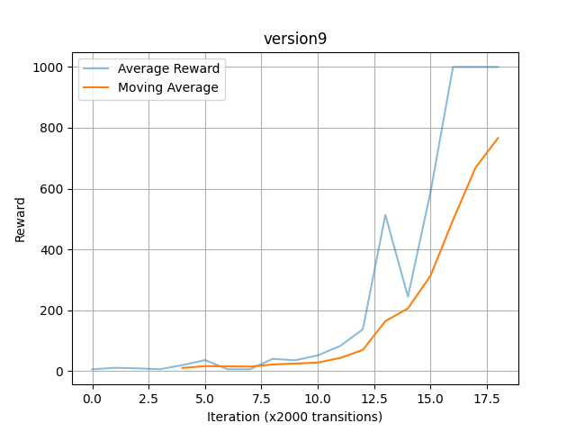
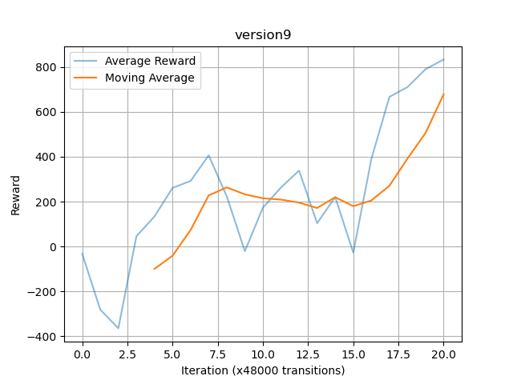

# Policy Gradients

REINFORCE built up one idea at a time: from maximum likelihood to reward-to-go, baselines, learned value baselines, parallel environments and continuous actions.

---

## Theory

Please note that the theory corresponding to the codes is hosted on this [page](https://parag1604.github.io/notes/Reinforcement-Learning/Policy-Gradients).

## Python Environment Setup

Python >= 3.10, then:

```bash
pip install -r requirements.txt
```

- `gymnasium>=1.1` is needed for the vector-environment API used in `version8.py` and `version10.py`.
- `gymnasium[box2d]` (LunarLander, versions 7 and 8) needs `swig` to build (`brew install swig` on macOS).
- `gymnasium[mujoco]` (InvertedPendulum and HalfCheetah, versions 9 and 10) installs MuJoCo.
- Versions 1 to 6 only need CartPole, which ships with plain `gymnasium`.

## Data

No dataset is needed. `version1.py` generates a synthetic two-class dataset, and every other version collects its own data by interacting with [Gymnasium](https://gymnasium.farama.org/) environments.

## Running

Every script has `--help`, a `--max-iters` option for a quick run and a `--render` flag to watch the trained policy. The reward curve is saved to `plots/versionN.png` (the greedy policy's average return after every update) and the policy to `models/` (both git-ignored). The plots below are from the original runs.

### 1. Maximum likelihood (`version1.py`)

```bash
python version1.py
```

A small MLP classifier on synthetic data, trained by minimising $-\log p_\theta(y \mid x)$. This is the starting point because the policy gradient is a *weighted* maximum-likelihood gradient: version2 reuses the same loss with states as inputs and actions as labels. Expect 100% test accuracy and `plots/version1.png` with the decision boundary.

### 2. REINFORCE (`version2.py`)

```bash
python version2.py        # CartPole-v0
```

Sample trajectories with $\pi_\theta$, weight each $\log \pi_\theta(a_t \mid s_t)$ by the return $R(\tau)$ of its whole trajectory, take one gradient step. It stops once the last 10 evaluations average above 195; the original run took about 60 updates of 1000 transitions, a re-run with the default seed about 27.


### 3. Baseline (`version3.py`)

```bash
python version3.py
```

New: subtract the batch-average return, $R(\tau) - b$. CartPole rewards are all positive, so without a baseline every action is pushed up; with it only better-than-average trajectories are. Solved in about 25 updates.

### 4. Reward-to-go (`version4.py`)

```bash
python version4.py [--gamma 1.0]
```

New: by causality, an action only gets credit for the rewards that come after it, the reward-to-go $\hat Q_t = \sum_{t' \ge t} \gamma^{t'-t} r_{t'}$, which also introduces the discount $\gamma$ (default 0.99; `--gamma 1.0` gives the lecture's undiscounted estimator). The baseline is left out on purpose, so compare it with version2.

### 5. Reward-to-go + baseline, normalised (`version5.py`)

```bash
python version5.py        # CartPole-v1
```

New: both tricks together, with the advantages normalised to mean 0 and std 1. It reaches the CartPole-v1 maximum of 500 in about 25 to 35 updates.


### 6. Recurrent policy over a history of observations (`version6.py`)

```bash
python version6.py [--hide-velocity]
```

New: an LSTM policy that sees the last 3 observations. CartPole's observation is already Markov, so with `--hide-velocity` (only position and angle are observed) you can see why memory matters under partial observability. The estimator is unchanged. Learning is slower than with the MLP: a re-run reached an average of about 115 after 80 updates of 500 transitions.

### 7. Learned state-dependent baseline $V_\phi(s)$ (`version7.py`)

```bash
python version7.py        # LunarLander-v3, 40 000 transitions per update
```

New: a value network $V_\phi(s_t)$ regressed onto the rewards-to-go, giving advantages $\hat A_t = \hat Q_t - V_\phi(s_t)$. Lands the lunar lander (average return above 200) in about 60 updates. (The title inside the original plot reads "version6"; the files were renumbered afterwards.)


### 8. Parallel environments (`version8.py`)

```bash
python version8.py
```

New: the same algorithm, but the batch is collected from 16 environment copies stepped together (`gymnasium.make_vec`), so the policy runs on batches of observations. In the original runs this cut the wall-clock time from about 3500 s to about 750 s.

### 9. Continuous actions: Gaussian policy (`version9.py`)

```bash
python version9.py        # InvertedPendulum-v5 (MuJoCo)
```

New: $\pi_\theta(a \mid s) = \mathcal{N}(\mu_\theta(s), \sigma^2)$ with a learned $\log\sigma$; the sampled action is squashed with $\tanh$ into the action bounds. It reaches the maximum return of 1000 in about 20 updates of 2000 transitions.



### 10. Everything together on HalfCheetah (`version10.py`)

```bash
python version10.py       # HalfCheetah-v5 (MuJoCo)
```

New: version8's machinery (learned baseline, parallel environments) with version9's Gaussian policy, plus truncated rollouts (`--max-steps 150`): long episodes are cut into short segments, which is harmless with $\gamma = 0.95$. The original run reached an average return of about 800 in 20 updates of 48 000 transitions (the title inside the plot reads "version9").



Next steps: bootstrapping the value function inside the advantage gives actor-critic methods (see the [Actor-Critic](https://github.com/parag1604/Actor-Critic) repository).
