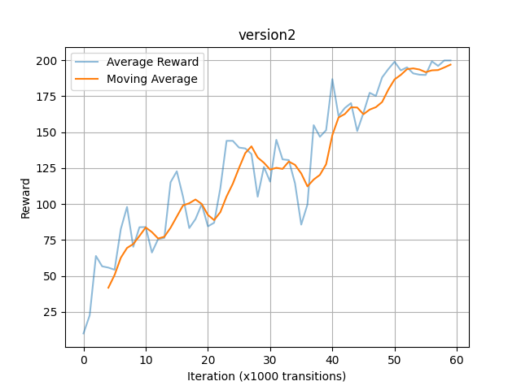
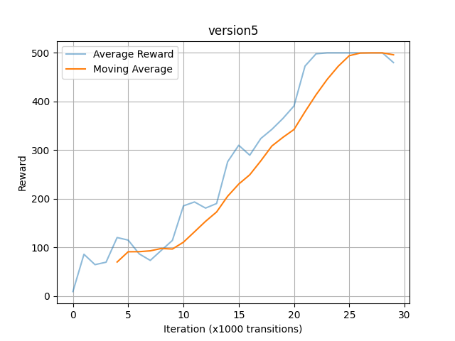
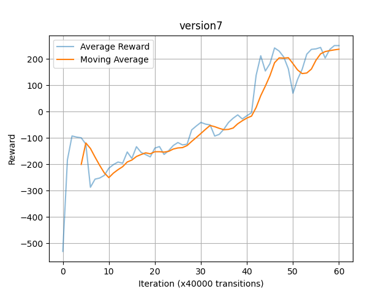
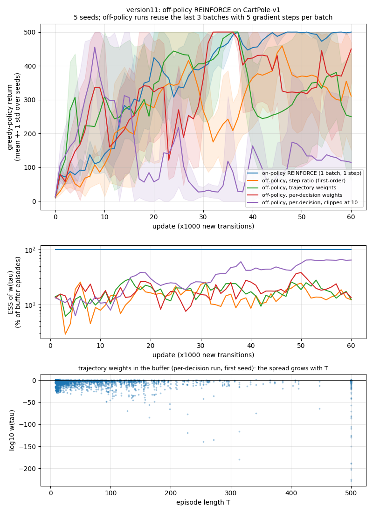

# Policy Gradients

REINFORCE built up one idea at a time: from maximum likelihood to reward-to-go, baselines, learned value baselines, parallel environments, continuous actions and, finally, off-policy learning with importance sampling.

---

## Theory

Please note that the theory corresponding to the codes is hosted on this [page](https://parag1604.github.io/notes/Reinforcement-Learning/Policy-Gradients).

## Python Environment Setup

Python >= 3.10, then:

```bash
pip install -r requirements.txt
```

- `gymnasium>=1.1` is needed for the vector-environment API used in `version8.py` and `version10.py`.
- `gymnasium[box2d]` (LunarLander, versions 7 and 8) needs `swig` to build (`brew install swig` on macOS).
- `gymnasium[mujoco]` (InvertedPendulum and HalfCheetah, versions 9 and 10) installs MuJoCo.
- Versions 1 to 6 and 11 only need CartPole, which ships with plain `gymnasium`.

## Data

No dataset is needed. `version1.py` generates a synthetic two-class dataset, and every other version collects its own data by interacting with [Gymnasium](https://gymnasium.farama.org/) environments.

## Running

Every script has `--help`, a `--max-iters` option for a quick run and a `--render` flag to watch the trained policy. The reward curve is saved to `plots/versionN.png` (the greedy policy's average return after every update) and the policy to `models/` (both git-ignored). The plots below are from the original runs.

### 1. Maximum likelihood (`version1.py`)

```bash
python version1.py
```

A small MLP classifier on synthetic data, trained by minimising $-\log p_\theta(y \mid x)$. This is the starting point because the policy gradient is a *weighted* maximum-likelihood gradient: version2 reuses the same loss with states as inputs and actions as labels. Expect 100% test accuracy and `plots/version1.png` with the decision boundary.

### 2. REINFORCE (`version2.py`)

```bash
python version2.py        # CartPole-v0
```

Sample trajectories with $\pi_\theta$, weight each $\log \pi_\theta(a_t \mid s_t)$ by the return $R(\tau)$ of its whole trajectory, take one gradient step. It stops once the last 10 evaluations average above 195; the original run took about 60 updates of 1000 transitions, a re-run with the default seed about 27.



### 3. Baseline (`version3.py`)

```bash
python version3.py
```

New: subtract the batch-average return, $R(\tau) - b$. CartPole rewards are all positive, so without a baseline every action is pushed up; with it only better-than-average trajectories are. Solved in about 25 updates.

### 4. Reward-to-go (`version4.py`)

```bash
python version4.py [--gamma 1.0]
```

New: by causality, an action only gets credit for the rewards that come after it, the reward-to-go $\hat Q_t = \sum_{t' \ge t} \gamma^{t'-t} r_{t'}$, which also introduces the discount $\gamma$ (default 0.99; `--gamma 1.0` gives the lecture's undiscounted estimator). The baseline is left out on purpose, so compare it with version2.

### 5. Reward-to-go + baseline, normalised (`version5.py`)

```bash
python version5.py        # CartPole-v1
```

New: both tricks together, with the advantages normalised to mean 0 and std 1. It reaches the CartPole-v1 maximum of 500 in about 25 to 35 updates.



### 6. Recurrent policy over a history of observations (`version6.py`)

```bash
python version6.py [--hide-velocity]
```

New: an LSTM policy that sees the last 3 observations. CartPole's observation is already Markov, so with `--hide-velocity` (only position and angle are observed) you can see why memory matters under partial observability. The estimator is unchanged. Learning is slower than with the MLP: a re-run reached an average of about 115 after 80 updates of 500 transitions.

### 7. Learned state-dependent baseline $V_\phi(s)$ (`version7.py`)

```bash
python version7.py        # LunarLander-v3, 40 000 transitions per update
```

New: a value network $V_\phi(s_t)$ regressed onto the rewards-to-go, giving advantages $\hat A_t = \hat Q_t - V_\phi(s_t)$. Lands the lunar lander (average return above 200) in about 60 updates.



### 8. Parallel environments (`version8.py`)

```bash
python version8.py
```

New: the same algorithm, but the batch is collected from 16 environment copies stepped together (`gymnasium.make_vec`), so the policy runs on batches of observations. In the original runs this cut the wall-clock time from about 3500 s to about 750 s.

### 9. Continuous actions: Gaussian policy (`version9.py`)

```bash
python version9.py        # InvertedPendulum-v5 (MuJoCo)
```

New: $\pi_\theta(a \mid s) = \mathcal{N}(\mu_\theta(s), \sigma^2)$ with a learned $\log\sigma$; the sampled action is squashed with $\tanh$ into the action bounds. It reaches the maximum return of 1000 in about 20 updates of 2000 transitions.


### 10. Everything together on HalfCheetah (`version10.py`)

```bash
python version10.py       # HalfCheetah-v5 (MuJoCo)
```

New: version8's machinery (learned baseline, parallel environments) with version9's Gaussian policy, plus truncated rollouts (`--max-steps 150`): long episodes are cut into short segments, which is harmless with $\gamma = 0.95$. The original run reached an average return of about 800 in 20 updates of 48 000 transitions.


### 11. Off-policy REINFORCE with importance sampling (`version11.py`)

```bash
python version11.py                              # per-decision weights (default)
python version11.py --weights trajectory         # or: step
python version11.py --clip 10                    # truncated importance weights
python version11.py --compare --max-iters 60 --updates-per-batch 5   # the plot below
```

New: a replay buffer. Every version so far throws a batch away after one gradient step; here the last 3 batches (`--buffer-batches`) are kept and reused, optionally for several gradient steps per batch (`--updates-per-batch`). Those trajectories were sampled by older policies $\pi_b$, so each term is reweighted with the ratios $\rho_t = \pi_\theta(a_t \mid s_t)/\pi_b(a_t \mid s_t)$; the dynamics cancel, so we only store $\log \pi_b(a_t \mid s_t)$ when the action is sampled. Three weightings are implemented (see the [off-policy section of the lecture](https://parag1604.github.io/notes/Reinforcement-Learning/Policy-Gradients#off-policy-policy-gradients)):

- `trajectory`: the whole-trajectory weight $w(\tau) = \prod_t \rho_t$ on every term. Unbiased.
- `per-decision`: causal weights. Reward $r_{t'}$ only depends on actions up to $t'$, so it carries $\rho_{0:t'} = \prod_{k \le t'} \rho_k$, and the gradient term at $t$ is $\nabla \log \pi_\theta(a_t \mid s_t)\big[\sum_{t' \ge t} \gamma^{t'-t} \rho_{0:t'} r_{t'} - \rho_{0:t}\, b\big]$. Still unbiased, with less variance.
- `step`: only the current ratio $\rho_t$, the lecture's "first-order" approximation that ignores the mismatch in state distributions. Biased, but its variance does not grow with the horizon; fine while $\pi_\theta$ stays close to $\pi_b$ (the idea behind TRPO/PPO). This is what the original course code did.

**Why the variance grows with the horizon.** $\log w(\tau) = \sum_t \log \rho_t$ is a sum of $T$ random terms. Each $\rho_t$ has mean 1 under $\pi_b$, so $\mathbb{E}[w] = 1$, but $\mathbb{E}[\rho_t^2] \ge 1$, and for roughly independent steps $\operatorname{Var}[w] = \prod_t \mathbb{E}[\rho_t^2] - 1$ grows exponentially in $T$. A few trajectories get huge weights and the rest almost none. The script prints the effective sample size $\text{ESS} = (\sum w)^2/\sum w^2$ of the buffer after every update, and the bottom panel below plots $\log_{10} w(\tau)$ against the episode length. `--clip c` caps every weight at $c$ (truncated importance sampling), which bounds the variance at the price of bias.

**What we ran and what happened.** `python version11.py --compare --max-iters 60 --updates-per-batch 5`: 5 seeds per variant, each trained for exactly 60 updates of 1000 new transitions (no early stop), on the CPU of an Apple-silicon Mac (about 45 minutes in all on a busy machine). On-policy REINFORCE is version5's update (one batch, one gradient step); the off-policy runs keep the last 3 batches and take 5 gradient steps on them per new batch.

| Variant | First evaluation >= 475 (update, per seed) | Mean return over the last 10 updates |
|---|---|---|
| on-policy REINFORCE | 20, 20, 19, 36, 17 | 494 |
| off-policy, step ratio | 12, never, 21, 22, 40 | 336 |
| off-policy, trajectory weights | 22, 9, 4, 7, 3 | 327 |
| off-policy, per-decision weights | 7, 29, 5, 8, 17 | 378 |
| off-policy, per-decision, clipped at 10 | 8, 8, 5, 14, 6 | 126 |

- **Reusing data helps early.** With the importance weights, most off-policy runs first balance the pole for 475+ steps after 3 to 9 updates, against about 20 for on-policy REINFORCE: 15 gradient steps per 1000 new transitions instead of 1.
- **But it is less stable.** By the end, on-policy REINFORCE sits at 500 in every seed, while every off-policy variant has seeds that fell back. The effective sample size (middle panel) stays at 10 to 30% of the buffer episodes: a handful of trajectories carry most of the gradient. The bottom panel shows why: $\log_{10} w(\tau)$ spreads out further as episodes get longer, down to $10^{-200}$ for some 500-step episodes.
- **Clipping made things worse here.** In 3 of 5 seeds the clipped run collapsed to a policy that always pushes the same way (return 9). Clipping the weights at $c$ is biased, and the bias interacts with the baseline: the term $-\rho_{0:t}\, b$ has zero mean only with the exact weights. Capped weights shrink it exactly for the actions the current policy now prefers, so the baseline term keeps pushing their probability up, a feedback loop towards a deterministic policy. In a quick check with 3 seeds and no baseline, the clipped estimator did not collapse but learned more slowly. Practical methods clip per-step ratios inside a trust region instead (PPO) or with a learned value function (V-trace, Retrace).
- With the default `--updates-per-batch 1` (the original course setting), all three weightings behave much like on-policy REINFORCE (first 475+ after 15 to 25 updates in a 3-seed check): the policy barely moves between batches, so the weights stay close to 1.



Changes from the original course code (`offpolicy_reinforce.py`), which this version is based on: the buffer used to be cut to its last 3000 transitions, which could chop off the start of the oldest episode, so whole episodes are now dropped; the trajectory and per-decision weights and clipping are new (the original had only the per-step ratio); ratios are computed in log space; and the code is ported from the old `gym` API to `gymnasium` (it also no longer calls `sys.exit()` when solved).

Next steps: bootstrapping the value function inside the advantage gives actor-critic methods (see the [Actor-Critic](https://github.com/parag1604/Actor-Critic) repository).
